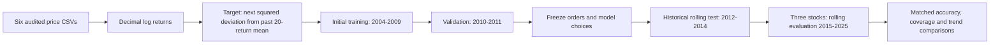
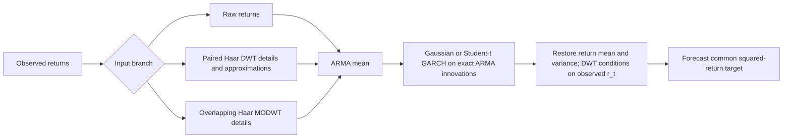
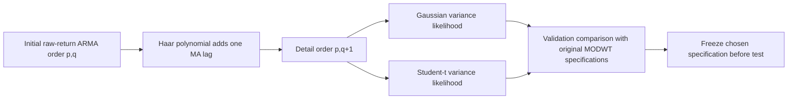
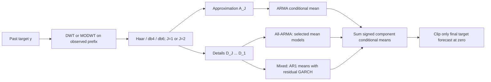
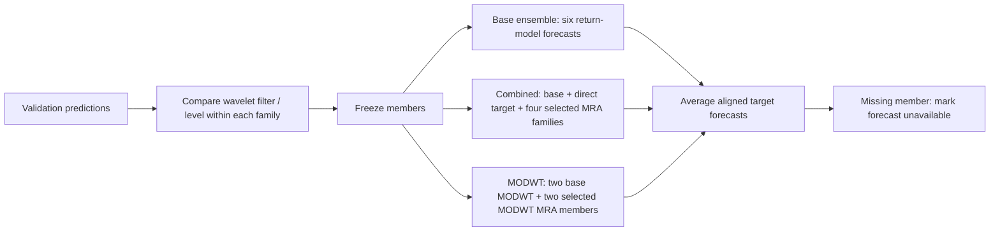
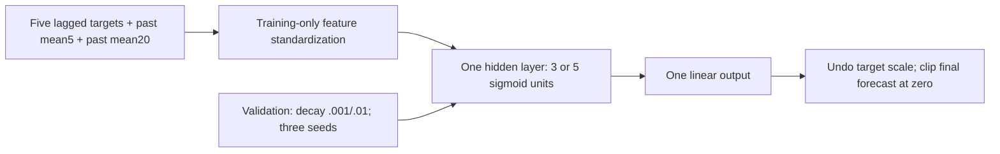

# Final experiment architecture

## Shared data and evaluation



Each forecast sees only the observed prefix. A return at the forecast date never
enters fitting, target centering, feature scaling or wavelet decomposition for
that forecast. Trading calendars are retained separately. The 1,024-observation
window is a rolling fit window within the declared training/history bounds.

## Core return-based models



For decimal log returns `r`, the target is
`y[t+1]=(r[t+1]-mean(r[t-19:t]))^2`. A return mean/variance forecast is mapped by
`yhat=h+(mu-moving_mean)^2`. For Haar MODWT,
`w[t]=(r[t]-r[t-1])/2`, `mu_r=r[t]+2*mu_w`, `h_r=4*h_w`.

**Paired (decimated) Haar DWT.** The forecast pair is `(r[t], r[t+1])`, and
`r[t]` is already observed. The fitting history is the sequence of complete
past pairs `(u_k, v_k)` ending with `(r[t-2], r[t-1])` (an odd prefix drops its
oldest return). Each pair gives a detail `d_k=(v_k-u_k)/sqrt(2)` and an
approximation `a_k=(v_k+u_k)/sqrt(2)`. Two ARMA(-GARCH) models of the same
specification, one per coefficient series (orders chosen separately by AIC),
give one-step moments `d ~ (mu_d, h_d)` and `a ~ (mu_a, h_a)` for the next pair.
With `s = a - d = sqrt(2)*r[t]` observed, and `a`, `d` treated as conditionally
uncorrelated (Haar is orthonormal) and jointly normal:

```
E[d | s]   = mu_d - h_d/(h_a+h_d) * (s - (mu_a - mu_d))
Var(d | s) = h_a*h_d/(h_a+h_d)
r[t+1] = r[t] + sqrt(2)*d  =>  mu_r = r[t] + sqrt(2)*E[d|s],  h_r = 2*h_a*h_d/(h_a+h_d)
```

For iid returns with mean m and variance s2 this gives `mu_r=m`, `h_r=s2`, the
raw-return forecast. `tests/run_tests.R` checks this on simulated iid returns. Code:
`R/wavelets.R::paired_haar_components`, `restore_paired_dwt_moments`.

ARMA parameters use Gaussian ML by `stats::arima(method='CSS-ML')` (conditional
sum-of-squares start, exact likelihood finish), with an exact-ML Rossignol (2011)
initialisation as fallback. Gaussian or variance-standardized
Student-t GARCH(1,1) parameters are then fitted to those fixed mean-model
innovations. This is two-step estimation, not joint ARMA-GARCH maximum likelihood.
Fixed-coefficient exact state-space filtering updates states between refits.

## Refinement: likelihood and mean-order rule



The extra-lag rule is motivated by multiplication of the raw MA polynomial by
`(1-B)/2`. It does not impose an exact unit MA root in the numerical fit. MA(q)
is not white noise when its lag coefficients are nonzero. A deterministic
transformation cannot guarantee additional population forecast information.

## Extension 1: component modeling of the target



There are 24 component specifications. Prefix-only reflection and exact additive
reconstruction are checked. The decomposition at each origin uses only the
observed prefix (leakage test: changing future values changes no forecast), but
the components inside the prefix come from two-sided synthesis filters while the
last values depend on the boundary reflection. The component ARMA models are
therefore fitted on smoothed history and applied at the boundary; this is a
methodological caveat, not leakage. These models operate directly on `y`, unlike the
core models operating on returns. In the mixed branch, GARCH estimates component
residual variances; those variances are **not** added to the component means.
If that unused GARCH step fails to converge, the AR(1) mean is kept and the
variance failure is recorded (`variance_error` in `diagnostics.csv`) instead of
discarding the forecast.
The mixed branch's point-forecast difference therefore comes from its mean
allocation; it is not an isolated proof that adding component GARCH improves a
two-step conditional-mean forecast.

## Extension 2: equal-weight forecast ensembles



No test-derived weights are fitted. Membership stays identical in the historical
and later tests for each stock. A failed member never silently reduces the
number of members being averaged.

## Extension 3: neural network



`nnet::nnet` uses squared-error training. Prediction loads the `nnet` namespace
in the calling process first, so a worker that only restores a saved fit gives the
same forecast as the worker that fitted it, no skip connections and a 300-iteration
cap. Hyperparameters are selected by the mean validation MSE across three seeds.
All test seeds are reported. Iteration-limit fits are flagged as unavailable for
accuracy evaluation. If no architecture is fully valid across seeds, the
declared 5-unit/0.01-decay fallback is tested and its fallback status is recorded.

## Parameter sensitivity


Wavelet filter/level/allocation and MLP size/decay/seed effects are assessed in
their complete declared model grids. Window/cadence/order sensitivity is applied
to the three core GARCH pipelines, not claimed as a full Cartesian search over
every parameter of every extension. The stock later-period jobs are split by
independent frozen model groups, preserving the same individual forecasts.

A refit that fails is attempted again at the next origin; there is no fallback to
the previous fit. The forecast for that origin is marked failed, and the refit
phase of that model shifts afterwards. This is deterministic and keeps failures
visible.
